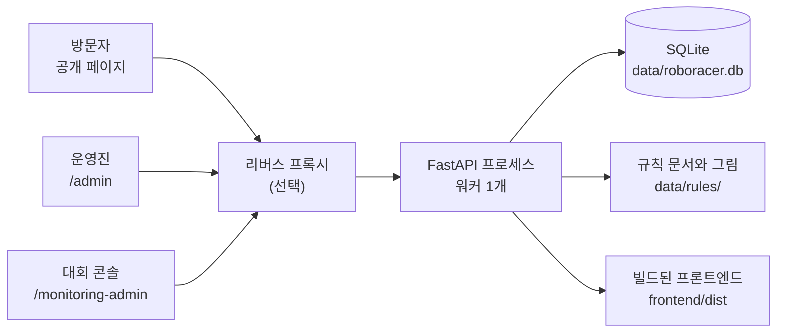
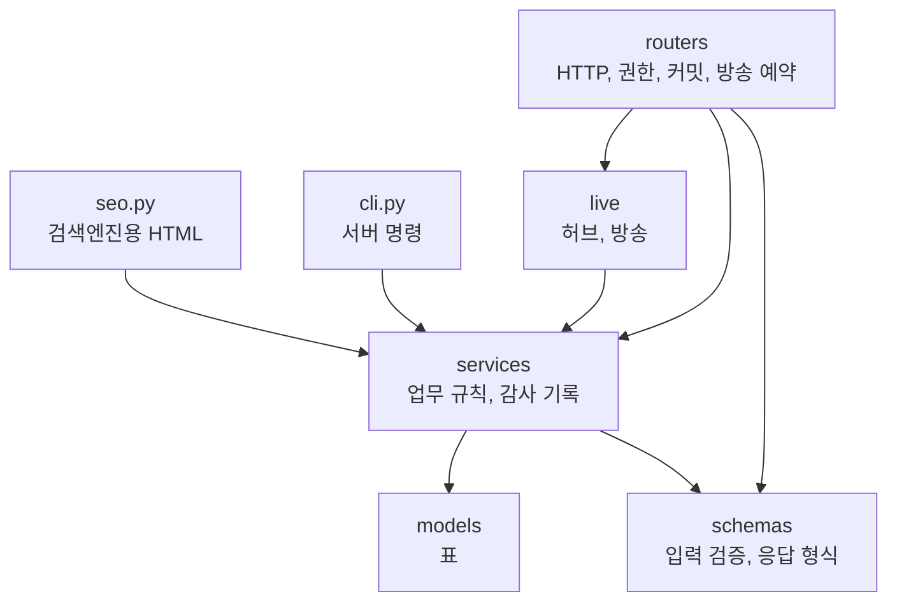
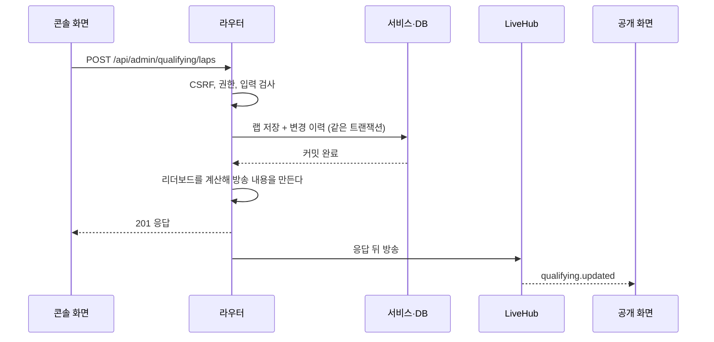
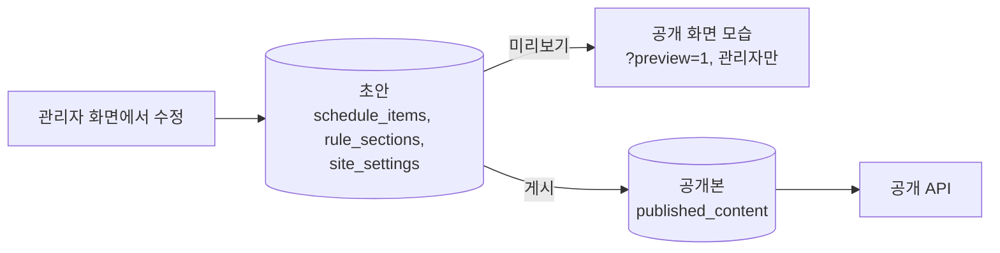

# 아키텍처

이 사이트가 어떻게 짜여 있는지 설명한다. 설치와 운영 명령은 [README](../README.md), 경로별 입출력은 [API 명세](API.md), 표 구조는 [데이터베이스](DATABASE.md), 순위 계산과 대진 규칙은 [대회 로직](DOMAIN.md)에 있다.

## 한눈에 보기

FastAPI 프로세스 하나가 API, WebSocket, 빌드된 프론트엔드를 모두 내주고, 데이터는 SQLite 파일 하나에 둔다.



사이트는 네 부분으로 나뉜다.

| 부분 | 주소 | 쓰는 사람 | 하는 일 |
|---|---|---|---|
| 공개 페이지 | `/`, `/schedule`, `/rules`, `/apply`, `/live`, `/results` | 누구나 | 소개, 일정, 규칙, 신청, 모니터링, 결과 |
| 큰 화면 | `/live?display=1` | 프로젝터 | 모니터링을 어두운 전체 화면으로 |
| 대회 콘솔 | `/monitoring-admin` | 운영진 | 대회 당일 입력. 로그인 또는 비밀 값 주소(`?pw=`)로 연다 |
| 관리자 화면 | `/admin` | 관리자 | 팀, 대진 모양, 일정, 규칙, 설정, 계정, 변경 이력. 심판은 대시보드만 본다 |

## 기술 스택

| 영역 | 사용 |
|---|---|
| 백엔드 | Python 3.12, FastAPI, Uvicorn, SQLAlchemy 2, Alembic, pydantic-settings, argon2-cffi |
| 프론트엔드 | Vite, React 19, TypeScript, React Router, TanStack Query, i18next, CSS Modules |
| Markdown 표시 | @uiw/react-markdown-preview, remark-gfm, remark-cjk-friendly, rehype-sanitize |
| 데이터 | SQLite (WAL) |
| 도구 | uv, npm, pytest, ruff, vitest, eslint, prettier, openapi-typescript, Playwright, sharp |
| 실행 | Docker Compose 또는 직접 실행 |

정확한 버전은 `backend/uv.lock`, `frontend/package-lock.json` 에 고정되어 있다.

## 저장소 구조

```
├── backend/
│   ├── alembic/versions/      DB 구조 변경
│   ├── app/
│   │   ├── main.py            앱 생성, 라우터 연결, 시작 절차
│   │   ├── config.py          환경 설정
│   │   ├── db.py              DB 연결
│   │   ├── auth.py            세션, 권한, 콘솔 비밀 값, 시도 제한
│   │   ├── errors.py          오류 형식
│   │   ├── seo.py             검색엔진용 HTML, 사이트맵
│   │   ├── static.py          프론트엔드 파일 제공
│   │   ├── cli.py             서버 명령
│   │   ├── routers/           HTTP 경로
│   │   ├── schemas/           요청·응답 형식 (Pydantic)
│   │   ├── services/          업무 로직
│   │   ├── models/            표 정의 (SQLAlchemy)
│   │   └── live/              WebSocket 허브와 방송
│   ├── data/                  DB, 규칙 문서와 그림 (git 제외)
│   └── tests/
├── frontend/
│   ├── assets-src/hero/       히어로 원본 이미지
│   ├── public/                그대로 배포되는 파일 (히어로, 로고, 아이콘)
│   ├── scripts/               이미지 변환, 점검 스크린샷
│   └── src/
│       ├── app/               앱 뼈대, 헤더, 푸터, 메뉴
│       ├── api/               API 호출, 생성된 타입, mock
│       ├── components/        공용 UI
│       ├── features/          기능별 코드 (live, content, home, schedule, rules, apply, preview)
│       ├── pages/             페이지. admin/ 은 관리자 화면, monitor/ 는 대회 콘솔
│       ├── i18n/              번역 문구
│       ├── lib/               랩타임, 시간, 언어 선택 등 도구
│       └── styles/            디자인 토큰, 전역 CSS
├── docker/entrypoint.sh       마이그레이션 후 서버 시작
├── Dockerfile
├── docker-compose.yml
└── docker-compose.override.example.yml
```

## 백엔드

### 계층



- **routers:** 경로마다 권한을 함수 인자의 타입(`AdminUser`, `MonitorActor`, `CurrentUser`)으로 정한다. 트랜잭션 커밋과 방송 예약도 여기서 한다.
- **services:** 대회 규칙은 모두 여기에 있다. 서비스는 커밋하지 않고 `flush` 까지만 하므로, 라우터와 서버 명령이 같은 함수를 함께 쓴다.
- **schemas:** 길이, 범위 같은 입력 검증을 맡는다. FastAPI 가 이것으로 OpenAPI 를 만들고, 프론트엔드 타입은 그 OpenAPI 에서 만든다.

| 서비스 | 맡은 일 |
|---|---|
| `leaderboard.py` | 예선 순위 계산 |
| `ranking.py` | 저장된 랭킹 |
| `bracket.py` | 대진 편집, 결과 입력, 진출, 시드, 동결 |
| `mapping.py` | 맵핑 순서, 예선 출전 순서 |
| `practice.py` | 그룹 연습 조 |
| `teams.py` | 기권 처리 |
| `results.py` | 시상 |
| `live_state.py` | 진행 상태 |
| `site_settings.py` | 키-값 설정 |
| `publishing.py` | 초안과 공개본, 게시 |
| `schedule_document.py` | 일정 ⇄ Markdown |
| `rules_document.py`, `rules_markdown.py` | 규칙 ⇄ Markdown, 서버의 규칙 파일 |
| `rules_package.py`, `rules_refs.py` | 규칙 ZIP, 그림 주소 찾기 |
| `audit.py` | 변경 이력 |
| `demo.py` | 데모 데이터 |

### 앱 시작 절차

`app/main.py` 의 `create_app()` 이 앱을 만든다.

1. 설정을 읽고 DB 엔진과 세션 공장을 만든다.
2. `LiveHub` 와 시도 제한 두 벌(로그인, 콘솔 비밀 값)을 만들어 `app.state` 에 둔다.
3. 라우터를 연결한다. `/api/admin` 전체에 CSRF 검사와 `Cache-Control: no-store` 를 건다.
4. 오류 처리기를 걸고, 없는 경로는 프론트엔드 파일이나 검색엔진용 HTML 로 답하게 한다(`static.py`).
5. 시작할 때 서버의 규칙 문서를 DB 내용으로 다시 쓰고, 공개본이 없으면 지금 내용으로 만든다. 둘 다 실패해도 서버는 뜬다.

컨테이너에서는 `docker/entrypoint.sh` 가 그 전에 `alembic upgrade head` 를 실행한다.

### 요청 하나의 흐름

대회 콘솔에서 랩을 입력할 때를 예로 든다.



오류는 모두 `{detail, code}` 형식으로 나간다. 업무 오류는 `AppError` 로 던지고, `errors.py` 가 입력 검증 오류, 버전 충돌, DB 유일 제약 위반까지 같은 형식으로 바꾼다.

## 프론트엔드

### 구성

- **앱 뼈대:** `app/App.tsx` 에 라우트가 있다. 공개 페이지는 `Layout` 안에 있고, 대회 콘솔과 관리자 화면은 따로 불러온다(첫 화면이 가벼워지도록).
- **서버 데이터:** TanStack Query 로 가져온다. 쿼리 키는 `api/queryKeys.ts` 한곳에 모았고, 기본 `staleTime` 은 30초다. 4xx 오류는 다시 시도하지 않는다.
- **API 호출:** `api/client.ts` 하나로 한다. 변경 요청에 `X-Requested-With` 를 붙이고, 콘솔 비밀 값이 있으면 `X-Monitor-Key` 를 붙이며, 오류를 `ApiError` 로 바꾼다.
- **타입:** REST 타입은 `api/schema.d.ts`(OpenAPI 에서 생성)에서 가져온다. WebSocket 메시지 타입만 `features/live/types.ts` 에 손으로 쓴다.
- **문구:** `i18n/locales/` 에 한국어와 영어가 있다. `ko.json`·`en.json` 은 공개 화면, `admin.*.json` 은 관리자 화면과 콘솔이다. DB 내용은 `lib/localized.ts` 의 `pickLocalized` 로 고르고, 영어가 비어 있으면 한국어를 보인다.
- **스타일:** UI 라이브러리 없이 CSS Modules 를 쓴다. 색, 간격, 서체 값은 `styles/tokens.css` 의 변수만 쓴다.
- **큰 화면:** `/live?display=1` 은 헤더와 푸터를 숨기고 진행 단계에 맞춰 탭을 저절로 바꾼다(`features/live/liveTab.ts`).

### Mock 모드

`VITE_USE_MOCK=true` 면 백엔드 없이 돈다. `api/client.ts` 가 `fetch` 대신 `api/mock/server.ts` 를 부르고, `api/mock/live.ts` 가 3초마다 가짜 랩을 만든다. 변경 요청은 읽기 전용 오류로 답한다. 화면 구석에 `MOCK` 표시가 나온다. 이 모드에서는 `LIVE_FEED_ON` 과 상관없이 가짜 실시간이 돈다.

### 테스트 사이트 빌드

`VITE_TEST_SITE=true` 로 빌드하면 모든 화면 맨 위에 주황색 띠가 나오고 탭 제목 앞에 `[테스트]` 가 붙는다. `VITE_REAL_SITE_URL` 을 주면 띠에 실제 사이트 링크가 나온다. Dockerfile 빌드 인자로 넘긴다. 운영 빌드에는 나오지 않는다.

## 실시간 연결

**지금은 꺼 두었다.** 대회가 끝나 `features/live/useLiveFeed.ts` 의 `LIVE_FEED_ON` 을 `false` 로 두었다. 프론트엔드가 소켓을 열지 않으므로 열어 둔 화면은 저절로 갱신되지 않고, 새로고침하거나 30초(`staleTime`)가 지난 뒤 페이지에 다시 들어오면 새 값을 받는다. 상태 줄의 연결 칸은 숨고, 관리자 대시보드에는 '꺼짐'으로 보인다. 서버의 `/ws/live` 와 방송 코드는 그대로 있다.

**다시 켜려면** `LIVE_FEED_ON` 을 `true` 로 바꿔 배포한다. 프록시 설정은 README 의 [리버스 프록시](../README.md#리버스-프록시-뒤에서-운영할-때) 절을 따른다.

켜져 있을 때의 동작은 다음과 같다.

- **서버:** `live/hub.py` 의 `LiveHub` 가 연결 목록과 `seq` 를 메모리에 둔다. 스냅샷과 방송이 같은 잠금을 쓰므로 순서가 섞이지 않는다. 허브가 메모리에 있어서 **uvicorn 워커는 반드시 1개**다. 로그인 시도 제한도 같은 이유로 프로세스 메모리에 있다.
- **방송:** 라우터가 커밋한 뒤 `live/events.py` 의 `Events` 를 부른다. 내용은 그때 만들고, 전송은 응답 뒤로 미룬다(`BackgroundTasks`).
- **클라이언트:** `features/live/LiveProvider.tsx` 가 앱 루트에서 소켓을 하나만 연다. 대회 기록은 메시지 내용으로 쿼리 캐시를 바로 바꾸고(`setQueryData`), 일정·규칙·설정·팀·랭킹은 알림만 받아 다시 가져온다(`invalidateQueries`). 메시지별 처리는 `features/live/messages.ts` 에 있다.
- **재연결:** 25초마다 ping 을 보내고, 60초 동안 아무 메시지가 없으면 끊고 다시 연결한다. 재시도 간격은 1초부터 두 배씩 늘어 최대 10초다. 네트워크가 돌아오거나 화면이 다시 보이면 기다리지 않고 바로 연결한다.

## 초안과 게시

일정, 규칙, 사이트 설정은 고쳐도 바로 공개되지 않는다. 대회 기록과 팀, 계정, 콘솔 비밀 값은 바로 적용된다.



- 공개본은 공개 화면에 보일 모습을 통째로 JSON 으로 담는다. 공개 API 는 초안 표를 읽지 않는다.
- 미리보기는 `?preview=1` 로 연 탭에서 공개 API 대신 `/api/admin/preview/…` 를 읽는다. 상태는 `sessionStorage` 에 둔다(`features/preview/`).
- 처음 배포할 때는 서버가 시작하면서 지금 내용으로 공개본을 만든다. 그 뒤로는 게시해야 바뀐다.
- 서버 명령으로 초안을 고쳤다면 `publish` 명령으로 게시한다.

## 인증과 보안

자세한 규칙은 [API 명세](API.md#인증과-권한)에 있다.

- **비밀번호:** argon2 로 해시한다. 기본 계정은 없고 첫 관리자는 서버 명령으로 만든다. 없는 아이디로 로그인해도 같은 시간이 걸린다.
- **세션:** DB 에 저장하고 `HttpOnly`, `SameSite=Strict` 쿠키로 준다. 비활성화하거나 비밀번호를 바꾸면 그 계정의 세션을 모두 지운다.
- **CSRF:** `SameSite=Strict` 에 더해 변경 요청에 `X-Requested-With: fetch` 를 요구한다.
- **콘솔 비밀 값:** 상수 시간으로 비교한다. 주소에 값이 들어가므로 화면은 `noindex` 와 `no-referrer` 를 건다. 서버 접속 기록에는 주소가 남으므로 새었다고 생각되면 바로 바꾼다. 이 값으로는 콘솔에 필요한 API 만 쓸 수 있고, 팀·일정·규칙·설정·계정 API 와 대진 모양 편집은 열리지 않는다.
- **시도 제한의 IP:** 프록시 뒤에서는 `FORWARDED_ALLOW_IPS` 에 프록시 대역만 적는다. `*` 로 두면 방문자가 `X-Forwarded-For` 를 꾸며 제한을 피할 수 있다.
- **Markdown:** 규칙 본문의 HTML 은 `rehype-sanitize` 로 걸러서 그린다. 규칙 그림은 SVG 를 받지 않는다(같은 origin 에서 스크립트가 돌 수 있으므로).
- **ZIP 올리기:** 경로 탈출, 심볼릭 링크, 암호, 크기와 개수 한도를 검사한다. 임시 폴더에 다 푼 뒤 제자리로 옮긴다.
- **개인정보:** 팀원 이름, 연락처 같은 칸이 없다. 참가 신청은 외부 폼이 받는다.

## 검색엔진

공개 화면은 브라우저가 그리는 SPA 라 서버의 HTML 이 비어 있다. 그래서 `seo.py` 가 `index.html` 을 내줄 때 페이지마다 다음을 넣는다.

- 제목, 설명, 대표 그림(OG·트위터 카드)
- `PUBLIC_URL` 이 있으면 대표 주소(canonical)
- 첫 화면에는 구글 행사 정보용 구조화 데이터(schema.org Event)
- `#root` 안에 게시한 내용으로 만든 본문. 자바스크립트를 돌리지 않는 검색엔진도 읽을 수 있고, React 가 그리면서 바꾼다

관리자 화면과 대회 콘솔은 `noindex` 다. 앱이 모르는 주소는 화면은 같고 상태만 404 다. 사이트맵은 `PUBLIC_URL` 이 있을 때만 내고, 닫아 게시한 페이지는 넣지 않는다.

## 배포 구조

Docker 이미지는 두 단계로 만든다. Node 로 프론트엔드를 빌드하고, Python 이미지에 백엔드와 빌드 결과를 넣는다. 컨테이너는 uid 1000 으로 돌고, `backend/data` 를 볼륨으로 둔다.

- **서브패스 배포:** 프론트엔드를 `VITE_BASE_PATH=/roboracer/` 로 빌드하면 라우터, API, WebSocket 주소가 모두 그 경로를 쓴다. 프록시는 그 경로를 떼고 넘기므로 백엔드는 경로를 모른다. 세션 쿠키 범위는 `COOKIE_PATH` 로 좁힌다.
- **기계별 설정:** `docker-compose.override.yml` 에 둔다. git 에 올리지 않고, 예시만 `docker-compose.override.example.yml` 로 올린다.
- **데이터:** DB 와 규칙 문서·그림은 모두 `backend/data` 안에 있어 다시 빌드해도 남는다.

### 환경 설정

`backend/.env` 또는 환경 변수로 준다.

| 이름 | 기본값 | 뜻 |
|---|---|---|
| `APP_ENV` | `development` | `production` 이면 `/api/docs` 를 끄고 `seed-demo` 를 거부한다 |
| `DATABASE_URL` | `sqlite:///./data/roboracer.db` | DB 위치 |
| `SESSION_TTL_HOURS` | `12` | 세션 수명 |
| `COOKIE_SECURE` | `false` | HTTPS 면 `true` |
| `COOKIE_PATH` | `/` | 세션 쿠키 범위 |
| `EVENT_TIMEZONE` | `Asia/Seoul` | 화면 표시와 일정 문서의 시간대 |
| `FRONTEND_DIST` | `../frontend/dist` | 빌드된 프론트엔드 위치 |
| `RULES_DIR` | `./data/rules` | 규칙 문서와 그림 위치 |
| `CORS_ORIGINS` | 없음 | 쉼표로 구분. 같은 origin 으로 운영하면 비운다 |
| `LOG_LEVEL` | `info` | 로그 수준 |
| `PUBLIC_URL` | 없음 | 공개 주소(끝에 `/`). 대표 주소와 사이트맵에 쓴다 |
| `GOOGLE_SITE_VERIFICATION`, `NAVER_SITE_VERIFICATION` | 없음 | 검색엔진 소유 확인 값 |

프론트엔드 빌드 값은 `VITE_BASE_PATH`, `VITE_API_BASE`, `VITE_USE_MOCK`, `VITE_TEST_SITE`, `VITE_REAL_SITE_URL`, `VITE_HIDE_ADMIN_LINK` 이고, 개발 서버의 백엔드 주소는 `DEV_BACKEND` 다. uvicorn 의 `FORWARDED_ALLOW_IPS` 는 프록시를 쓸 때 준다.

## 테스트

| 영역 | 도구 | 위치 | 하는 일 |
|---|---|---|---|
| 백엔드 | pytest | `backend/tests/` | 테스트마다 임시 SQLite 로 API, 대회 로직, 마이그레이션, 문서 변환, 정적 파일, WebSocket 을 확인한다 |
| 프론트엔드 | vitest | `frontend/src/**/*.test.ts` | 랩타임, 시간, 언어 선택, 실시간 메시지 처리, 대진 배치 같은 순수 로직을 확인한다 |
| 화면 점검 | Playwright | `frontend/scripts/shots.mjs` | mock 모드 화면을 여러 크기와 언어로 찍는다 |

실행 명령은 [README](../README.md#개발)에 있다. 실제 데이터(`backend/data`)로 시험하지 않는다.
