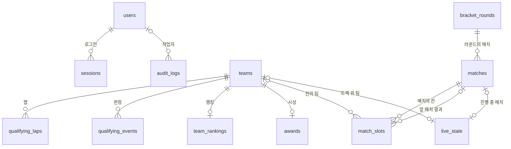

# 데이터베이스

SQLite 한 파일(기본 `backend/data/roboracer.db`)에 모든 데이터를 둔다. 표 정의의 원본은 [`backend/app/models/`](../backend/app/models/), 구조 변경은 [`backend/alembic/versions/`](../backend/alembic/versions/) 다.

## 1. 공통 규칙

- **연결 설정:** 연결마다 `journal_mode=WAL`, `foreign_keys=ON`, `busy_timeout=5000` 을 건다.
- **구조 변경:** 앱은 표를 직접 만들지 않고 Alembic 마이그레이션으로만 바꾼다. 컨테이너가 시작할 때 `alembic upgrade head` 를 실행한다. SQLite 의 `ALTER` 제약 때문에 batch 모드를 쓴다.
- **시각:** 모두 UTC 로 저장하고 읽을 때 시간대를 붙인다. 시간대가 없는 값은 저장을 거부한다.
- **공통 칸:** `published_content` 를 뺀 모든 표에 `created_at`, `updated_at` 이 있다.
- **동시 수정:** `schedule_items`, `rule_sections`, `teams`, `qualifying_laps`, `matches` 의 `version` 은 낙관적 잠금에 쓴다. 값은 앱이 올리고 `UPDATE` 때 이전 값을 함께 확인한다.
- **개인정보:** 팀원 이름, 연락처, 이메일, 학번 같은 칸을 두지 않는다. 팀 표에는 공개해도 되는 이름과 소속만 둔다.

## 2. 표 사이의 관계



`updated_by`, `recorded_by`, `published_by` 는 모두 `users.id` 를 가리킨다. 그림을 단순하게 하려고 뺐다.

## 3. 표

### users

관리자·심판 계정과 시스템 계정 `monitoring`.

| 칸 | 형식 | 빈 값 | 기본값 | 연결·제약 | 설명 |
|---|---|---|---|---|---|
| `id` | 정수 |  |  | 기본 키 |  |
| `username` | 문자열(32) |  |  | 유일 | `monitoring` 은 시스템 계정 전용 |
| `password_hash` | 문자열 |  |  |  | argon2. 시스템 계정은 `!` 라서 로그인되지 않는다 |
| `role` | 문자열(16) |  |  |  | `admin` 또는 `referee` |
| `is_active` | 참/거짓 |  | true |  |  |
| `is_system` | 참/거짓 |  | false |  | 시스템 계정. 로그인할 수 없고 계정 목록에 안 나온다 |
| `created_at` | 시각(UTC) |  | 지금 |  |  |
| `updated_at` | 시각(UTC) |  | 지금 |  |  |

### sessions

로그인 세션. id 가 쿠키 `rr_session` 의 값이다.

| 칸 | 형식 | 빈 값 | 기본값 | 연결·제약 | 설명 |
|---|---|---|---|---|---|
| `id` | 문자열(64) |  |  | 기본 키 | `secrets.token_urlsafe(32)` |
| `user_id` | 정수 |  |  | → `users.id` (지우면 함께 지움), 색인 |  |
| `expires_at` | 시각(UTC) |  |  |  |  |
| `created_at` | 시각(UTC) |  | 지금 |  |  |
| `updated_at` | 시각(UTC) |  | 지금 |  |  |

### audit_logs

변경 이력. 관리자 변경 요청과 같은 트랜잭션에서 쌓인다.

| 칸 | 형식 | 빈 값 | 기본값 | 연결·제약 | 설명 |
|---|---|---|---|---|---|
| `id` | 정수 |  |  | 기본 키 |  |
| `user_id` | 정수 | 가능 |  | → `users.id`, 색인 | null 은 서버 명령 |
| `action` | 문자열(32) |  |  |  | `create`, `update`, `delete`, `void`, `finish`, `reopen`, `seed`, `swap`, `import`, `publish`, `bracket_freeze` 등 |
| `entity` | 문자열(64) |  |  |  | 표 이름 |
| `entity_id` | 문자열(64) |  |  |  |  |
| `before_json` | 문자열 | 가능 |  |  | 바꾸기 전 값(JSON) |
| `after_json` | 문자열 | 가능 |  |  | 바꾼 뒤 값(JSON) |
| `created_at` | 시각(UTC) |  | 지금 |  |  |
| `updated_at` | 시각(UTC) |  | 지금 |  |  |

### site_settings

키-값 설정. 키 목록은 [아래](#4-site_settings-키)에 있다.

| 칸 | 형식 | 빈 값 | 기본값 | 연결·제약 | 설명 |
|---|---|---|---|---|---|
| `key` | 문자열(64) |  |  | 기본 키 |  |
| `value` | 문자열 |  | 빈 글 |  | 모두 문자열 |
| `updated_by` | 정수 | 가능 |  | → `users.id` (지우면 비움) | null 은 서버 명령 |
| `created_at` | 시각(UTC) |  | 지금 |  |  |
| `updated_at` | 시각(UTC) |  | 지금 |  |  |

### published_content

공개 사이트에 게시한 모습. 공개 API 는 초안 표 대신 이 표를 읽는다.

| 칸 | 형식 | 빈 값 | 기본값 | 연결·제약 | 설명 |
|---|---|---|---|---|---|
| `resource` | 문자열(16) |  |  | 기본 키 | `schedule`, `rules`, `settings` |
| `data` | JSON |  |  |  | 공개 화면에 보일 모습 전체(JSON) |
| `published_at` | 시각(UTC) |  |  |  |  |
| `published_by` | 정수 | 가능 |  | → `users.id` (지우면 비움) | null 은 서버 명령이나 처음 시작할 때 만든 것 |

### schedule_items

일정 초안.

| 칸 | 형식 | 빈 값 | 기본값 | 연결·제약 | 설명 |
|---|---|---|---|---|---|
| `id` | 정수 |  |  | 기본 키 |  |
| `starts_at` | 시각(UTC) |  |  | 색인 |  |
| `ends_at` | 시각(UTC) | 가능 |  |  | `starts_at` 보다 뒤 |
| `title_ko` | 문자열 |  |  |  |  |
| `title_en` | 문자열 |  | 빈 글 |  |  |
| `location_ko` | 문자열 | 가능 |  |  |  |
| `location_en` | 문자열 | 가능 |  |  |  |
| `description_ko` | 문자열 | 가능 |  |  |  |
| `description_en` | 문자열 | 가능 |  |  |  |
| `sort_order` | 정수 |  | 0 |  | 시작 시각이 같을 때의 순서 |
| `is_published` | 참/거짓 |  | true |  | false 면 비공개 항목(게시해도 안 보인다) |
| `updated_by` | 정수 | 가능 |  | → `users.id` (지우면 비움) |  |
| `created_at` | 시각(UTC) |  | 지금 |  |  |
| `updated_at` | 시각(UTC) |  | 지금 |  |  |
| `version` | 정수 |  | 1 |  |  |

### rule_sections

규칙 섹션 초안. 서버의 Markdown 문서와 내용이 같다.

| 칸 | 형식 | 빈 값 | 기본값 | 연결·제약 | 설명 |
|---|---|---|---|---|---|
| `id` | 정수 |  |  | 기본 키 |  |
| `title_ko` | 문자열 |  |  |  |  |
| `title_en` | 문자열 |  | 빈 글 |  |  |
| `body_ko` | 문자열 |  | 빈 글 |  |  |
| `body_en` | 문자열 |  | 빈 글 |  |  |
| `sort_order` | 정수 |  | 0 | 색인 |  |
| `is_published` | 참/거짓 |  | true |  | false 면 비공개 항목(게시해도 안 보인다) |
| `level` | 정수 |  | 2 |  | 1 = 장(`#`), 2 = 절(`##`) |
| `updated_by` | 정수 | 가능 |  | → `users.id` (지우면 비움) |  |
| `created_at` | 시각(UTC) |  | 지금 |  |  |
| `updated_at` | 시각(UTC) |  | 지금 |  |  |
| `version` | 정수 |  | 1 |  |  |

### teams

팀. 모든 대회 기록의 기준이다. 지우지 않고 `is_active` 를 끈다.

| 칸 | 형식 | 빈 값 | 기본값 | 연결·제약 | 설명 |
|---|---|---|---|---|---|
| `id` | 정수 |  |  | 기본 키 |  |
| `name_ko` | 문자열 |  |  | 유일 | API 는 대소문자를 무시하고 겹침을 검사한다 |
| `name_en` | 문자열 |  | 빈 글 |  |  |
| `affiliation_ko` | 문자열 | 가능 |  |  |  |
| `affiliation_en` | 문자열 | 가능 |  |  |  |
| `is_active` | 참/거짓 |  | true |  | false 면 기권 또는 불참 |
| `inspected_at` | 시각(UTC) | 가능 |  |  | 차량 검사를 마친 시각 |
| `inspection_order` | 정수 | 가능 |  |  | 운영진이 직접 적은 검차 완료 순서. 있으면 `inspected_at` 보다 먼저 쓴다 |
| `mapping_order` | 정수 | 가능 |  |  | 맵핑 순서(1부터, 무작위로 섞음) |
| `mapped_at` | 시각(UTC) | 가능 |  |  | 맵핑을 마친 시각 |
| `qualifying_order` | 정수 | 가능 |  |  | 예선 출전 순서. 한 팀이라도 값이 있으면 맵핑 순서는 동결 상태다 |
| `practice_group` | 문자열(1) | 가능 |  |  | 그룹 연습 조 `A`, `B`, `C` |
| `practice_group_at` | 시각(UTC) | 가능 |  |  | 조를 고른 시각 |
| `created_at` | 시각(UTC) |  | 지금 |  |  |
| `updated_at` | 시각(UTC) |  | 지금 |  |  |
| `version` | 정수 |  | 1 |  |  |

### qualifying_laps

예선 랩 하나. 지우지 않고 입력 취소(`void`)로 표시한다.

| 칸 | 형식 | 빈 값 | 기본값 | 연결·제약 | 설명 |
|---|---|---|---|---|---|
| `id` | 정수 |  |  | 기본 키 |  |
| `team_id` | 정수 |  |  | → `teams.id`, 색인 |  |
| `attempt_no` | 정수 |  |  |  | 팀별로 1부터. 입력 취소한 번호도 다시 쓰지 않는다 |
| `mission` | 문자열(2) |  | Q1 |  | `Q1`, `Q2`, `Q3` |
| `lap_time_ms` | 정수 | 가능 |  |  | 밀리초. Q3 유효 랩에는 꼭 있다 |
| `status` | 문자열(8) |  |  |  | `valid`, `invalid`, `void` |
| `void_reason` | 문자열 | 가능 |  |  | 입력을 취소한 사유 |
| `recorded_by` | 정수 | 가능 |  | → `users.id` (지우면 비움) | null 은 서버 명령 |
| `recorded_at` | 시각(UTC) |  |  | 색인 |  |
| `created_at` | 시각(UTC) |  | 지금 |  |  |
| `updated_at` | 시각(UTC) |  | 지금 |  |  |
| `version` | 정수 |  | 1 |  |  |

(`team_id`, `attempt_no`) 묶음은 유일하다.

### qualifying_events

예선 판정. 지우면 판정을 취소한 것이다.

| 칸 | 형식 | 빈 값 | 기본값 | 연결·제약 | 설명 |
|---|---|---|---|---|---|
| `id` | 정수 |  |  | 기본 키 |  |
| `team_id` | 정수 |  |  | → `teams.id` (지우면 함께 지움), 색인 |  |
| `kind` | 문자열(16) |  |  |  | `fa_lost`, `rank_drop` |
| `reason` | 문자열 |  |  |  |  |
| `recorded_by` | 정수 | 가능 |  | → `users.id` (지우면 비움) | null 은 서버 명령 |
| `recorded_at` | 시각(UTC) |  |  |  |  |
| `created_at` | 시각(UTC) |  | 지금 |  |  |
| `updated_at` | 시각(UTC) |  | 지금 |  |  |

### team_rankings

운영진이 저장한 랭킹. 본선 시드는 이 표로 채운다.

| 칸 | 형식 | 빈 값 | 기본값 | 연결·제약 | 설명 |
|---|---|---|---|---|---|
| `team_id` | 정수 |  |  | 기본 키, → `teams.id` (지우면 함께 지움) |  |
| `rank` | 정수 |  |  | 유일 | 1부터 |
| `created_at` | 시각(UTC) |  | 지금 |  |  |
| `updated_at` | 시각(UTC) |  | 지금 |  |  |

### awards

시상. 본선 결과에서 계산하지 않고 운영진이 정한 대로 적는다. 순위는 두지 않는다.

| 칸 | 형식 | 빈 값 | 기본값 | 연결·제약 | 설명 |
|---|---|---|---|---|---|
| `team_id` | 정수 |  |  | 기본 키, → `teams.id` (지우면 함께 지움) |  |
| `award` | 문자열(16) |  |  |  | `grand`, `excellence`, `merit` |
| `sort_order` | 정수 |  | 0 |  | 같은 상 안에서 보이는 순서 |
| `created_at` | 시각(UTC) |  | 지금 |  |  |
| `updated_at` | 시각(UTC) |  | 지금 |  |  |

### bracket_rounds

본선 라운드.

| 칸 | 형식 | 빈 값 | 기본값 | 연결·제약 | 설명 |
|---|---|---|---|---|---|
| `id` | 정수 |  |  | 기본 키 |  |
| `name_ko` | 문자열 |  |  |  |  |
| `name_en` | 문자열 |  | 빈 글 |  |  |
| `sort_order` | 정수 |  | 0 |  |  |
| `created_at` | 시각(UTC) |  | 지금 |  |  |
| `updated_at` | 시각(UTC) |  | 지금 |  |  |

### matches

본선 매치.

| 칸 | 형식 | 빈 값 | 기본값 | 연결·제약 | 설명 |
|---|---|---|---|---|---|
| `id` | 정수 |  |  | 기본 키 |  |
| `round_id` | 정수 |  |  | → `bracket_rounds.id` (지우면 함께 지움), 색인 |  |
| `label` | 문자열(20) |  |  | 유일 | 화면에 보이는 경기 이름(예: `Race 1`) |
| `sort_order` | 정수 |  | 0 |  |  |
| `status` | 문자열(16) |  | scheduled |  | `scheduled`, `live`, `finished` |
| `scheduled_at` | 시각(UTC) | 가능 |  |  |  |
| `created_at` | 시각(UTC) |  | 지금 |  |  |
| `updated_at` | 시각(UTC) |  | 지금 |  |  |
| `version` | 정수 |  | 1 |  |  |

### match_slots

매치의 칸. 팀을 직접 갖거나, 랭킹 순위나 앞 매치 결과로 채운다.

| 칸 | 형식 | 빈 값 | 기본값 | 연결·제약 | 설명 |
|---|---|---|---|---|---|
| `id` | 정수 |  |  | 기본 키 |  |
| `match_id` | 정수 |  |  | → `matches.id` (지우면 함께 지움), 색인 |  |
| `slot_index` | 정수 |  |  |  | 매치 안에서 0부터 |
| `team_id` | 정수 | 가능 |  | → `teams.id` | 지금 이 칸의 팀 |
| `seed_rank` | 정수 | 가능 |  |  | 랭킹 N위로 채우는 칸 |
| `source_match_id` | 정수 | 가능 |  | → `matches.id` (지우면 비움), 색인 | 앞 매치 결과로 채우는 칸의 앞 매치 |
| `source_rank` | 정수 | 가능 |  |  | 앞 매치에서 받은 순위. 두 팀 경기는 1 = 승, 2 = 패 |
| `placeholder_ko` | 문자열 | 가능 |  |  | 팀이 없을 때 보일 글 |
| `placeholder_en` | 문자열 | 가능 |  |  |  |
| `result_rank` | 정수 | 가능 |  |  | 이 매치의 순위. 부전승 빈 칸은 null |
| `result_text` | 문자열 | 가능 |  |  | 결과 메모 |
| `created_at` | 시각(UTC) |  | 지금 |  |  |
| `updated_at` | 시각(UTC) |  | 지금 |  |  |

(`match_id`, `slot_index`) 묶음은 유일하다.

### live_state

현재 진행 상태. 행은 `id = 1` 하나뿐이다.

| 칸 | 형식 | 빈 값 | 기본값 | 연결·제약 | 설명 |
|---|---|---|---|---|---|
| `id` | 정수 |  |  | 기본 키 |  |
| `phase` | 문자열(16) |  | idle |  | `idle`, `mapping`, `practice`, `free_practice`, `qualifying`, `bracket`, `break`, `finished` |
| `on_track_team_id` | 정수 | 가능 |  | → `teams.id` (지우면 비움) | 트랙 위 팀 |
| `current_match_id` | 정수 | 가능 |  | → `matches.id` (지우면 비움) | 진행 중 매치 |
| `message_ko` | 문자열 | 가능 |  |  | 운영 공지 |
| `message_en` | 문자열 | 가능 |  |  |  |
| `bracket_frozen_at` | 시각(UTC) | 가능 |  |  | 본선 결과를 동결한 시각. 있으면 대진·결과를 바꿀 수 없다 |
| `created_at` | 시각(UTC) |  | 지금 |  |  |
| `updated_at` | 시각(UTC) |  | 지금 |  |  |

## 4. site_settings 키

| 키 | 값 | 게시 |
|---|---|---|
| `apply_form_url` | 신청 폼 주소 (`https://`) | 필요 |
| `apply_open_at`, `apply_close_at` | 접수 시작·마감 시각 (ISO 8601 UTC) | 필요 |
| `apply_close_date_only` | `1` 이면 마감을 날짜만 보인다 | 필요 |
| `page_<페이지>_open` | `0` 이면 닫힘, 없으면 열림. 페이지는 `schedule`, `rules`, `live` | 필요 |
| `page_<페이지>_note_ko`, `page_<페이지>_note_en` | 닫혔을 때 보일 안내 문구 | 필요 |
| `monitor_key` | 콘솔 비밀 값. 비어 있으면 끔 | 바로 적용, 공개본에 넣지 않음 |

DB 에 남은 다른 키는 읽지 않는다.

## 5. 마이그레이션

| 번호 | 내용 |
|---|---|
| `0001` | 처음 구조 |
| `0002` | 차량 번호 삭제, 팀 이름 유일, 랭킹 표, 시스템 계정 표시 |
| `0003` | 게시 공개본 표 |
| `0004` | 규칙 섹션의 단계(장, 절) |
| `0005` | 랩의 미션, 무효 랩, 차량 검사 시각, 예선 판정 표 |
| `0006` | 맵핑 순서와 마친 시각 |
| `0007` | 그룹 연습 조와 고른 시각 |
| `0008` | 예선 출전 순서 |
| `0009` | 검차 완료 순서 |
| `0010` | 본선 결과 동결 시각 |
| `0011` | 시상 표 |
| `0012` | 시상 표에서 순위 칸 삭제 |

표를 바꾸면 `backend/` 에서 마이그레이션을 만들고 모델과 맞는지 확인한다.

```bash
uv run alembic revision --autogenerate -m "바꾼 내용"
uv run alembic upgrade head
uv run alembic check
```

## 6. 백업과 복구

- 백업은 `python -m app.cli backup --out <파일>` 로 한다. SQLite 온라인 백업이라 서버가 돌고 있어도 된다. 파일을 그대로 복사하면 WAL 에 남은 내용을 놓칠 수 있다.
- 복구는 서버를 멈추고 백업 파일을 `roboracer.db` 자리에 넣은 뒤, 같은 폴더의 `roboracer.db-wal`, `roboracer.db-shm` 을 지우고 서버를 다시 띄운다.
- 규칙 그림과 규칙 문서는 DB 밖의 `RULES_DIR`(기본 `backend/data/rules`)에 있으므로 함께 보관한다.
