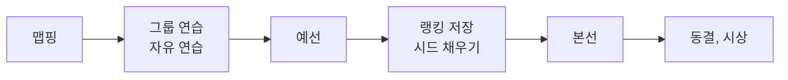

# 대회 로직

코드에 구현된 대회 규칙을 설명한다. 대회 규칙 문서 자체는 관리자 화면에서 관리하며 이 저장소에 없다. 코드 주석의 '규칙 4.7' 같은 번호는 그 문서의 번호다.

## 1. 전체 흐름

운영진이 대회 콘솔(`/monitoring-admin`)에서 진행 단계를 고르고 탭마다 입력한다.



| 단계 값 | 뜻 |
|---|---|
| `idle` | 대기 |
| `mapping` | 맵핑 |
| `practice` | 그룹 연습 |
| `free_practice` | 자유 연습 |
| `qualifying` | 예선 |
| `bracket` | 본선 |
| `break` | 휴식 |
| `finished` | 종료 |

단계는 화면 표시와 큰 화면의 탭 전환에 쓰인다. 단계가 입력을 막지는 않는다. 차량 검사는 단계가 따로 없고, 그룹 연습 조를 고르기 전에 마친다.

| 콘솔 탭 | 주소 | 입력하는 것 |
|---|---|---|
| 진행 상태 | `?tab=live` | 단계, 트랙 위 팀, 진행 중 매치, 공지 |
| 맵핑 | `?tab=mapping` | 맵핑 순서 섞기, 완료 표시 |
| 연습 조 | `?tab=practice` | 그룹 연습 조 |
| 예선 기록 | `?tab=qualifying` | 랩, 판정, 예선 출전 순서 |
| 랭킹·시드 | `?tab=ranking` | 차량 검사, 검차 순서, 랭킹, 시드 채우기 |
| 본선 결과 | `?tab=results` | 결과 입력, 되돌리기 |

코드는 `backend/app/services/` 에 있고, 절마다 파일을 적었다.

## 2. 맵핑 순서와 예선 출전 순서

파일: `mapping.py`

- 콘솔에서 참가 팀의 순서를 무작위로 섞어 `mapping_order` 에 적는다. 이미 맵핑을 마친 팀은 지금 순서대로 앞에 둔다. 공개 모니터링의 '맵핑' 탭에 그대로 보인다.
- 실제로 트랙에 오른 순서나 마친 순서가 아니라 **이 탭에 보이는 순서**가 기준이다.
- `freeze()` 는 이 순서를 `qualifying_order` 로 옮겨 적고 동결한다. API 나 화면에는 없고 서버 명령으로 실행한다([12절](#12-서버에서만-하는-작업)).
- 동결한 뒤에는 섞기, 전체 취소, 완료 표시가 409 `MAPPING_FROZEN` 이다. `qualifying_order` 가 한 팀이라도 있으면 동결 상태다.
- 예선 출전 순서는 동결한 뒤에도 콘솔에서 끌어 놓아 바꿀 수 있다(`PUT /api/admin/qualifying/order`). 맵핑 순서는 그대로 잠겨 있다.
- 기권한 팀을 빼고 1부터 다시 세어 보여 준다.

## 3. 예선 순위

파일: `leaderboard.py`. 계산은 저장하지 않고 요청할 때마다 한다.

### 미션

팀마다 Q1 → Q2 → Q3 을 차례로 통과한다.

| 미션 | 통과 조건 | 기록으로 쓰는 값 |
|---|---|---|
| Q1, Q2 | 유효 랩이 연속 3번 | 최대 연속 유효 랩 수 (최대 3) |
| Q3 | 랩타임이 있는 유효 랩이 하나라도 있음 | 가장 빠른 랩타임 |

- 무효 랩이 나오면 연속 랩을 0부터 다시 센다.
- 앞 미션을 통과하지 못했으면 뒤 미션의 기록은 순위에 쓰지 않는다.
- 입력 취소(`void`)한 랩은 없던 것으로 본다.
- 랩을 저장할 때 `mission` 을 보내지 않으면 서버가 그 순간의 진행으로 정한다. 화면이 갱신되기 전에 눌러도 맞게 들어간다.
- Q3 유효 랩에는 랩타임이 꼭 있어야 한다.

**FA** 는 세 미션을 모두 통과했고 'FA 달성 불가' 판정이 없는 상태다.

### 정렬

랩이 하나라도 있는 팀을 다음 순서로 정렬한다.

1. FA 달성
2. 통과한 미션 수 (많을수록)
3. 마지막 미션 기록
   - 셋 다 통과: Q3 최고 랩 (빠를수록)
   - 둘 통과: 같음 (Q3 유효 기록이 없다)
   - 하나 통과: Q2 연속 랩 (많을수록)
   - 못 통과: Q1 연속 랩 (많을수록)
4. 차량 검사 순서 ([아래](#차량-검사-순서))
5. 팀 ID

그다음 '최종 순위 1단계 강등' 판정을 적용한다. 아래 팀부터 옮겨서, 판정받은 팀이 저마다 받은 횟수만큼 내려가게 한다.

랩이 없는 팀은 순위 없이 맨 아래에 예선 출전 순서대로 둔다.

### 판정

`qualifying_events` 에 사유와 함께 저장한다. 행을 지우면 판정을 취소한 것이고, 변경 이력에는 남는다.

| `kind` | 뜻 | 횟수 |
|---|---|---|
| `fa_lost` | FA 달성 불가 | 한 팀에 한 번 |
| `rank_drop` | 최종 예선 순위 1단계 강등 | 여러 번 가능 |

### 차량 검사 순서

- 먼저 마친 팀이 앞선다. 운영진이 직접 적은 `inspection_order` 를 먼저 쓰고, 없으면 '검사 완료'를 누른 시각(`inspected_at`)을 쓴다.
- 직접 적는 번호는 겹칠 수 없다(409 `INSPECTION_ORDER_TAKEN`).
- 공개 리더보드에는 직접 적은 번호가 보인다.

### 랩타임

정수 밀리초로 저장하고, 0.01초 단위만 받는다. 표시는 `m:ss.SS` 이고, 입력은 `ss.SS` 또는 `m:ss.SS` 다(`frontend/src/lib/laptime.ts`).

## 4. 그룹 연습 조

파일: `practice.py`

- A·B·C 조의 정원과 시간이 코드의 `GROUPS` 에 있다(A 3팀, B 3팀, C 4팀).
- 차량 검사를 마친 팀만 고를 수 있다. 차량 검사 순서대로 고르는 것은 운영 절차이고, 서버가 순서를 막지는 않는다.
- 정원이 차면 409 `GROUP_FULL` 이다.
- 진행 상태에 함께 실려 공개 모니터링의 '연습' 탭에 보인다.

## 5. 랭킹과 시드

파일: `ranking.py`, `bracket.py`

- 랭킹(`team_rankings`)은 운영진이 저장한 순위다. 콘솔의 '예선 자동 순위로 채우기'는 화면의 목록을 채워 줄 뿐이고, 저장해야 반영된다. 예선 리더보드와 다르게 둘 수 있다.
- 본선의 '예선 N위' 칸은 리더보드가 아니라 **저장된 랭킹 N위**로 채운다. 랭킹을 바꿔도 '시드 채우기'를 해야 칸이 바뀐다.
- 다른 칸에 이미 있는 팀은 다시 넣지 않는다. 한 팀이 두 매치에 들어가는 일을 막는다.
- 경기가 하나라도 끝난 뒤에는 시드를 다시 채울 수 없다(409 `BRACKET_STARTED`). 기권으로 랭킹이 당겨진 상태에서 다시 채우면 다른 팀이 칸을 옮기기 때문이다.

## 6. 본선 대진

파일: `bracket.py`

### 구조

라운드 → 매치 → 칸으로 이루어진 범용 구조다. 대진 모양이 코드에 박혀 있지 않아서, 관리자 화면에서 자유롭게 만들거나 `generate` 로 싱글 엘리미네이션(2·4·8·16강, 3·4위전 선택)을 만들 수 있다.

칸은 세 가지 방법으로 채운다. 두 가지를 함께 쓸 수는 없다.

| 방법 | 칸 값 | 화면 표시 |
|---|---|---|
| 직접 지정 | `team_id` | 팀 이름 |
| 랭킹 순위 | `seed_rank` | '예선 3위' |
| 앞 매치 결과 | `source_match_id`, `source_rank` | 'Race 2 승', 'Race 7 패' |

순환 참조(매치가 자기 결과를 기다리게 되는 경우)와 한 매치 안의 중복(같은 팀, 같은 순위, 같은 출처)은 422 다.

### 결과 입력

`submit_result` 의 조건은 다음과 같다.

- 팀이 있는 모든 칸에 순위를 1부터 빠짐없이 매긴다. 두 팀 경기는 1 = 승, 2 = 패로 보인다.
- 빈 칸이 앞으로 채워질 수 있으면 끝낼 수 없다.
- 기권한 팀이 칸에 남아 있거나 같은 팀이 두 번 있으면 끝낼 수 없다.
- `version` 이 맞아야 한다.

끝내면 이 매치를 출처로 하는 칸마다 그 순위를 받은 팀을 채운다(`_propagate`). 칸이 바뀐 매치의 `version` 도 올라가므로, 낡은 화면에서 입력한 결과는 거절된다.

### 부전승

팀이 하나 이상 있고 빈 칸이 앞으로도 채워지지 않으면, 팀이 있는 칸만 순위를 매겨 끝낼 수 있다. 혼자면 1위로 올라간다. '채워지지 않는 칸'은 다음과 같다.

- 앞 매치가 끝났거나 없는 출처 칸
- 앞 매치의 칸도 모두 비어 있어 그 매치를 끝낼 수 없는 출처 칸
- 그 순위 팀이 없거나 그 팀이 이미 다른 칸에 있는 시드 칸
- 비워 둔 직접 지정 칸

### 되돌리기

`reopen_match` 는 결과를 지우고, 이 매치에서 팀을 받은 후속 칸을 비운다. 후속 매치가 이미 끝났으면 409 `DOWNSTREAM_FINISHED` 다. 끝난 뒤 기권한 팀은 그 칸에서 빠진다. 진행 중 매치로 잡혀 있으면 `live`, 아니면 `scheduled` 로 돌아간다.

### 칸 바꾸기

`swap_slots` 는 두 칸의 팀과 채우는 방법을 함께 맞바꾼다. 그래서 '예선 3위' 표시가 팀을 따라가고, 어떤 연결도 사라지지 않는다. 끝난 매치의 칸은 바꿀 수 없다. 로그인한 관리자만 쓸 수 있다.

### 진행 중 매치

진행 상태에서 진행 중 매치를 고르면 그 매치가 `live` 가 되고, 앞서 진행 중이던 매치는 `scheduled` 로 돌아간다. 끝난 매치는 건드리지 않는다.

## 7. 본선 결과 동결

파일: `bracket.py` 의 `freeze()`

- `live_state.bracket_frozen_at` 에 시각을 적으면 동결이다. API 나 화면에는 없고 서버 명령으로 실행한다([12절](#12-서버에서만-하는-작업)).
- 동결한 뒤에는 대진 편집, 칸 바꾸기, 시드 채우기, 결과 입력, 되돌리기가 모두 409 `BRACKET_FROZEN` 이다.
- 팀을 비활성화해도 대진 칸은 그대로 둔다.
- 화면에도 `bracket_frozen` 이 전달되어 콘솔과 관리자 화면이 보기 전용이 된다.
- 푸는 화면은 없다. 풀려면 DB 의 `bracket_frozen_at` 을 비운다.

## 8. 기권

파일: `teams.py`

팀의 `is_active` 를 끄면 같은 트랜잭션에서 다음을 한다.

1. 랭킹에서 빼고 아래 순위를 한 칸씩 당긴다.
2. 끝나지 않은 매치의 칸을 비운다(동결했으면 그대로 둔다).
3. 트랙 위 팀이면 비운다.

예선 기록과 끝난 매치의 결과는 남긴다. 리더보드와 공개 팀 목록에는 활성 팀만 나온다. 다시 활성화해도 랭킹과 대진 칸은 되돌리지 않는다. 참가(활성) 팀은 최대 15팀이다.

## 9. 시상

파일: `results.py`

- 본선 결과에서 계산하지 않고 운영진이 정한 대로 `awards` 표에 적는다. 공동 수상처럼 대진 결과와 다른 결정도 그대로 적을 수 있다.
- 공개 '결과' 페이지(`/results`)는 상만 보인다. 순위 칸은 없다.
- `write_awards()` 로 통째로 바꾼다. 관리자 화면에는 없고 서버 명령으로 실행한다([12절](#12-서버에서만-하는-작업)).

## 10. 일정과 규칙 문서

파일: `schedule_document.py`, `rules_markdown.py`, `rules_document.py`, `rules_package.py`, `rules_refs.py`

### 일정 문서

한 문서(`schedule.md`)에 한국어와 영어를 함께 쓴다. 올리면 일정 전체가 문서대로 바뀐다. 시각은 대회 시간대 기준이고, 형식이 틀리면 몇 번째 줄인지 알려 주며 아무것도 바꾸지 않는다.

```markdown
## 2026-11-01

### 09:00-10:00 일정 제목
- 장소: 장소 이름
- 영문: English title
- 영문 장소: English location
- 영문 설명: English description
그 밖의 줄은 한국어 설명이다.

### 10:00 끝 시각을 생략한 비공개 일정 <!-- hidden -->
```

다음 날 00:00 에 끝나는 일정은 `22:00-24:00` 으로 쓰고 화면에도 24:00 으로 보인다.

### 규칙 문서

언어마다 문서가 하나다(`rules.ko.md`, `rules.en.md`). 화면의 기준은 DB 이고, 파일은 DB 가 바뀔 때마다 다시 쓰는 사본이다. 바뀌기 전 파일은 `.bak` 으로 남는다.

```markdown
# 대회 규칙

## 공지
장 없이 쓴 절

# 1. 장 제목
<!-- hidden -->
장 본문. 위 표시는 비공개 섹션에 붙인다(한국어 문서만).

## 1.1 절 제목
절 본문. 소제목은 ### 부터 쓴다.
```

- `#` 은 장(`level` 1), `##` 는 절(`level` 2)을 시작한다. 그래서 섹션 본문에는 `#`, `##` 제목 줄을 쓸 수 없다.
- 맨 처음 `#` 줄이 '대회 규칙'·'Rules' 이거나 아래에 글 없이 바로 다음 제목이 오면 문서 제목으로 보고 건너뛴다.
- 한국어 문서는 섹션을 순서대로 덮어쓰고, 남는 섹션은 지우고, 모자라면 만든다.
- 영어 문서는 같은 자리 섹션의 영어 제목과 본문만 바꾼다. 내용을 위치로 짝짓는다. 섹션이 더 많거나 장·절 구조가 다르면 거절한다.
- 올릴 때 Notion 내보내기처럼 칸 안에 줄바꿈이 있는 표를 한 행으로 합친다(`normalize_tables`).

### 규칙 그림

- 문서와 그림을 ZIP 으로 올린다. 문서의 그림 주소(상대 경로, 패키지 경로, 작성자 컴퓨터의 절대 경로)를 ZIP 안에서 찾아 `RULES_DIR/files/` 에 저장하고, 본문 주소를 `/패키지 경로` 로 바꾼다.
- 찾는 순서는 정확한 경로, 경로 뒷부분이 가장 길게 같은 파일, 이름이 같은 파일이 하나뿐일 때 그 파일이다. 찾지 못해도 가져오기는 실패하지 않고 경고로 알린다.
- 문서를 올릴 때마다 어느 언어 본문도 쓰지 않는 그림을 지운다. 웹에서 본문을 고칠 때는 지우지 않는다.
- 한 언어의 ZIP 이 다른 언어가 쓰는 그림을 바꾸지 않는다. 같은 경로에 내용이 다른 그림이 있으면 파일 이름에 내용 해시를 붙여 저장한다.

## 11. 게시

파일: `publishing.py`. 구조는 [아키텍처](ARCHITECTURE.md#초안과-게시)에 있다.

- 게시 대상은 `schedule`, `rules`, `settings` 세 가지다.
- 초안과 공개본을 JSON 으로 비교해 '게시 전 변경'을 알린다. 예전 공개본은 지금 형식으로 다시 읽어 비교하므로, 칸이 늘어났다고 변경으로 보이지 않는다.
- 비공개 항목(`is_published=false`)은 게시해도 공개본에 들어가지 않는다.
- 공개본으로 되돌리는 '초안 버리기'는 없다. 공개본에는 비공개 항목과 `version` 이 없어 초안을 되살릴 수 없다.

## 12. 서버에서만 하는 작업

다음은 화면이 없다. 실제 DB 를 바꾸므로 먼저 백업한다([README](../README.md#백업)).

Docker 에서는 아래처럼 스크립트를 표준 입력으로 넘겨 실행한다.

```bash
docker compose exec -T app python - < 스크립트.py
```

**본선 결과 동결**

```python
from app.config import get_settings
from app.db import create_db_engine, create_session_factory
from app.services import bracket

factory = create_session_factory(create_db_engine(get_settings().database_url))
with factory() as db:
    bracket.freeze(db, None)
    db.commit()
```

**맵핑 순서 동결:** 위 스크립트에서 `bracket` 대신 `mapping` 을 가져와 `mapping.freeze(db, None)` 을 부른다.

**시상 입력:** 팀 ID 와 상을 보이는 순서대로 적는다. `award` 는 `grand`, `excellence`, `merit` 이다. 부를 때마다 표 전체를 바꾼다.

```python
from app.config import get_settings
from app.db import create_db_engine, create_session_factory
from app.schemas.competition import AwardItem
from app.services import results

items = [
    AwardItem(team_id=1, award="grand"),
    AwardItem(team_id=2, award="excellence"),
]
factory = create_session_factory(create_db_engine(get_settings().database_url))
with factory() as db:
    results.write_awards(db, items, None)
    db.commit()
```

작업자가 `None` 이면 변경 이력에 서버 명령으로 남는다. 서버가 돌고 있으면 공개 화면은 새로고침하거나 30초가 지난 뒤 페이지에 다시 들어와야 바뀐 내용이 보인다.

## 13. 다음 대회에 다시 쓸 때

대회마다 바꿔야 하는 값이 코드에 있는 곳이다.

| 위치 | 내용 |
|---|---|
| `frontend/src/i18n/locales/ko.json`, `en.json` | 대회명, 일시, 장소, 주최, 문의처, 소개, 시상 안내 |
| `frontend/index.html`, `frontend/src/pages/monitor/MonitorApp.tsx`, `frontend/src/features/home/Pitwall.tsx` | 대회 이름 |
| `backend/app/seo.py` | 대회명, 주최, 장소, 일시, 소개(화면 문구와 함께 고친다) |
| `backend/app/services/practice.py` | 연습 조의 정원과 시간 (`GROUPS`) |
| `frontend/public/sponsors/`, `frontend/src/features/home/NextUp.tsx` | 주최·후원 로고 |
| `frontend/assets-src/hero/` | 히어로 이미지 (`npm run build:hero` 로 다시 만든다) |
| `frontend/src/features/live/useLiveFeed.ts` | `LIVE_FEED_ON` 을 `true` 로 |

DB 에서 비우거나 다시 정할 것은 다음과 같다.

- 대회 기록: 팀, 랩, 판정, 랭킹, 대진, 시상
- 동결: `teams.qualifying_order`, `live_state.bracket_frozen_at`
- 내용: 일정, 규칙(입력한 뒤 게시), 신청 폼과 접수 기간, 콘솔 비밀 값
